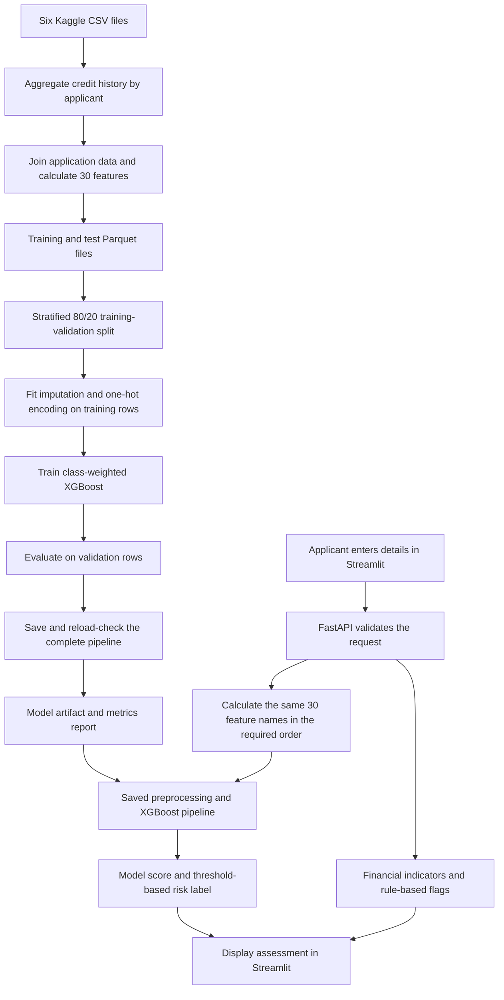

# Home Credit Risk Detection

Predict repayment difficulty from applicant information and credit history using
a **30-feature XGBoost model**, a **FastAPI backend**, and a **Streamlit UI**.
The repository has one workflow for preparing data, training the model, and
serving predictions.

## Contents

- [Workflow overview](#workflow-overview)
- [Setup and quick start](#setup-and-quick-start)
- [Dataset](#dataset)
- [Feature engineering](#feature-engineering)
- [Model training](#model-training)
- [Evaluation and saved results](#evaluation-and-saved-results)
- [Prediction workflow](#prediction-workflow)
- [API usage](#api-usage)
- [Run with Docker](#run-with-docker)
- [Configuration](#configuration)
- [Tests and CI](#tests-and-ci)
- [Project structure](#project-structure)
- [Troubleshooting](#troubleshooting)
- [Interpretation and limitations](#interpretation-and-limitations)

## Workflow overview

There are two connected paths: training builds a reusable model artifact;
inference loads that artifact to assess a submitted applicant.



`sk_id_curr` joins the historical tables during preparation. It is excluded from
the model inputs, and an applicant ID is not required for an API prediction.

## Setup and quick start

### 1. Install dependencies

Use **Python 3.11 or newer**. The commands below use Windows PowerShell and should
be run from the repository root. Calling the virtual environment's Python
directly avoids needing to activate it in every terminal.

```powershell
git clone https://github.com/abhikr1302/Home-Credit-Risk-Detection-Model.git
cd Home-Credit-Risk-Detection-Model

python -m venv .venv
.\.venv\Scripts\python.exe -m pip install -r requirements.txt
```

On macOS/Linux, replace `.\.venv\Scripts\python.exe` with `.venv/bin/python`.
The scikit-learn and XGBoost versions are pinned to support model compatibility.

### 2. Prepare data and train

Download and extract the [required dataset files](#dataset), then run:

```powershell
.\.venv\Scripts\python.exe -m src.feature_engineering
.\.venv\Scripts\python.exe -m src.train_model
```

If you already have a compatible, trusted model at
`models/xgboost_home_credit_pipeline.joblib`, you can go directly to serving it.
Git does not include the dataset or model binary, so a fresh clone needs one of
these two setup paths.

### 3. Start the backend

In the first terminal:

```powershell
.\.venv\Scripts\python.exe -m uvicorn src.api:app --host 127.0.0.1 --port 8000
```

### 4. Start the UI

In a second terminal, from the same repository:

```powershell
.\.venv\Scripts\python.exe -m streamlit run app.py
```

| Service | Address |
| --- | --- |
| Streamlit application | [http://localhost:8501](http://localhost:8501) |
| Interactive API documentation | [http://localhost:8000/docs](http://localhost:8000/docs) |
| Backend health check | [http://localhost:8000/health](http://localhost:8000/health) |

Keep both processes running while using the app. Press `Ctrl+C` in their
respective terminals to stop them.

## Dataset

The project uses the
[Home Credit Default Risk dataset](https://www.kaggle.com/competitions/home-credit-default-risk/data).
Download it through your Kaggle account and extract the following six files into
`data/raw/`. Keep the original filenames, including `POS_CASH_balance.csv`.

| File | Role in this project |
| --- | --- |
| `application_train.csv` | Applicant characteristics, requested loan details, external scores, and the training target |
| `application_test.csv` | Applicant records without the target; used to prepare a separate feature table |
| `bureau.csv` | Credit bureau account counts, active status, and outstanding debt |
| `previous_application.csv` | Previous applications and their approval/refusal outcomes |
| `credit_card_balance.csv` | Historical card balances and limits for utilization calculations |
| `POS_CASH_balance.csv` | Historical POS/Cash loan identifiers |

The binary target is `1` for the dataset's repayment-difficulty cases and `0` for
the other cases. It is a dataset-defined label, not a direct loan approval label.

```text
data/
  raw/
    application_train.csv
    application_test.csv
    bureau.csv
    previous_application.csv
    credit_card_balance.csv
    POS_CASH_balance.csv
  processed/
```

The current workflow does not require a database, a Kaggle API token, or an
external credit-bureau connection. It reads the downloaded CSVs directly.

## Feature engineering

Implementation: [`src/feature_engineering.py`](src/feature_engineering.py).

Running `python -m src.feature_engineering` performs these steps:

1. Reads only the needed CSV columns and normalizes column names to lowercase.
2. Converts birth and employment day values into years. Employment values outside
   0–100 years, including the dataset's sentinel value, become missing values.
3. Aggregates each credit-history table to one row per `sk_id_curr`.
4. Left-joins those aggregates onto each application, checking the join cardinality.
5. Calculates ratios and keeps exactly the configured 30 model features.
6. Checks for duplicate applicants, sorts by ID, and saves Parquet files.

Key calculations include:

| Feature | Calculation |
| --- | --- |
| `age_years` | `-days_birth / 365.25` |
| `employment_years` | `-days_employed / 365.25`, with invalid values marked missing |
| `ext_source_mean` | Mean of the available three external scores |
| `previous_approval_rate` | Approved previous applications / total previous applications |
| `previous_refusal_rate` | Refused previous applications / total previous applications |
| `credit_card_avg_utilization` | Mean of historical balance/limit ratios, with each ratio clipped to 0–5 |
| `active_bureau_account_ratio` | Active bureau accounts / total bureau accounts |
| `bureau_debt_to_annual_income_ratio` | Total bureau debt / annual income |
| `pos_cash_loan_count` | Number of distinct historical POS/Cash loan IDs |

Zero-denominator ratios and infinite values become missing values so the fitted
preprocessing pipeline can handle them consistently.

### The 30 model inputs

The authoritative feature list and its order live in
[`src/config.py`](src/config.py). They are grouped here for readability.

| Group | Features |
| --- | --- |
| External scores — 4 | `ext_source_1`, `ext_source_2`, `ext_source_3`, `ext_source_mean` |
| Applicant profile — 8 | `code_gender`, `name_education_type`, `name_income_type`, `name_housing_type`, `name_type_suite`, `name_family_status`, `flag_own_car`, `flag_own_realty` |
| Age and employment — 3 | `age_years`, `days_birth`, `employment_years` |
| Requested loan — 3 | `name_contract_type`, `amt_credit`, `amt_annuity` |
| Previous loan history — 4 | `previous_approval_rate`, `previous_refusal_rate`, `previous_refused_count`, `pos_cash_loan_count` |
| Credit exposure — 3 | `credit_card_avg_utilization`, `active_bureau_account_ratio`, `bureau_debt_to_annual_income_ratio` |
| Regional ratings — 2 | `region_rating_client`, `region_rating_client_w_city` |
| Social/document indicators — 3 | `def_30_cnt_social_circle`, `def_60_cnt_social_circle`, `flag_document_3` |

### Prepared files

| Output | Contents |
| --- | --- |
| `data/processed/model_features_train.parquet` | Applicant ID, 30 features, and `target` |
| `data/processed/model_features_test.parquet` | Applicant ID and the same 30 features |

The training script uses the training Parquet file. The prepared test file has no
labels and is not used to calculate validation metrics. The current scripts do
not automatically create a Kaggle submission from it.

## Model training

Implementation: [`src/train_model.py`](src/train_model.py).

Running `python -m src.train_model`:

1. Checks that the training file contains every required column, unique
   non-missing applicant IDs, and a complete target containing both `0` and `1`.
2. Selects the 30 configured features and excludes the ID and target.
3. Creates a **stratified 80% training / 20% validation split** with
   `random_state=42`.
4. Fits preprocessing on the training rows:
   - Numeric features: median imputation.
   - Categorical features: most-frequent imputation followed by one-hot encoding.
   - Unseen categories at prediction time: ignored by the encoder.
5. Trains XGBoost with class weighting calculated from the training split:
   `scale_pos_weight = non-default cases / default cases`.
6. Evaluates validation predictions and saves the model and metrics.
7. Reloads the saved pipeline and checks that sample predictions match.

Preprocessing and the classifier are saved together as a single scikit-learn
`Pipeline`. Inference therefore reuses the fitted imputers and encoder; it does
not fit them again for each applicant. One-hot encoding can expand the 30 raw
features into a larger number of encoded columns.

The main XGBoost settings are:

| Parameter | Value |
| --- | --- |
| Trees / maximum depth | `300` / `5` |
| Learning rate | `0.05` |
| Row / column sampling | `0.8` / `0.8` |
| Minimum child weight | `5` |
| L1 / L2 regularization | `0.1` / `1.0` |
| Objective / training metric | `binary:logistic` / `auc` |
| Tree method / random state | `hist` / `42` |

The saved model is fitted on the training portion of this split. The script does
not refit it on all labeled rows after evaluation.

### Saved artifacts

| Artifact | Purpose |
| --- | --- |
| `models/xgboost_home_credit_pipeline.joblib` | Fitted preprocessing and XGBoost classifier used by the API |
| `reports/final_model_metrics.json` | Validation scores, split sizes, threshold, and confusion matrix |

Rerunning feature preparation or training overwrites its respective outputs.
After retraining, restart the API to load the new artifact. Load joblib files
only from trusted sources.

## Evaluation and saved results

The current training script reports:

- **ROC-AUC:** how well scores rank the two classes across thresholds.
- **PR-AUC:** average precision, useful for assessing the minority repayment-difficulty class.
- **Precision:** the fraction of flagged cases that belong to the positive class.
- **Recall:** the fraction of positive cases that are flagged.
- **F1:** the balance between precision and recall at the selected threshold.
- **Confusion matrix:** `[[true negatives, false positives], [false negatives, true positives]]`.

Precision, recall, F1, and the confusion matrix depend on the configured
classification threshold. ROC-AUC and average precision are calculated from scores.

### Existing model report

The checked-in report preserves results for the existing saved model:

| Measurement | Recorded value |
| --- | --- |
| Training / validation applicants | `246,008` / `61,503` |
| Positive-class rate in the labeled dataset | `8.07%` |
| ROC-AUC | `0.7632` |
| PR-AUC / average precision | `0.2561` |
| Precision at cutoff `0.50` | `0.1742` |
| Recall at cutoff `0.50` | `0.6763` |
| F1 at cutoff `0.50` | `0.2770` |
| Best F1 recorded in that report | `0.3059` at cutoff `0.60` |

These are recorded validation results, not guaranteed performance on new data.
The retained report uses older keys such as `precision_at_0_50`. Rerunning the
current training script replaces it with `precision`, `recall`, `f1`, and
`confusion_matrix` measured at its recorded `threshold`—default **0.60**.
Compare threshold-dependent metrics only when their cutoffs match.

## Prediction workflow

Implementations: [`app.py`](app.py) and [`src/api.py`](src/api.py).

1. The user fills out the Streamlit form and selects **Check credit risk**.
2. Streamlit sends the banking inputs to the API's `POST /predict` endpoint.
3. Pydantic validates the request. Examples of checks include:
   - Age between 18 and 100; positive income, loan amount, and monthly EMI.
   - Finite numbers, non-negative counts, and external scores between 0 and 1.
   - Active accounts cannot exceed total accounts.
   - Approved plus refused applications cannot exceed previous applications.
   - A positive card balance requires a positive credit limit.
4. The backend converts inputs into the required feature names and order.
   Ownership becomes `Y`/`N`, age produces `days_birth`, and banking counts and
   amounts produce the historical ratios. Undefined ratios remain missing for
   the saved imputer.
5. The saved pipeline transforms the row and returns its positive-class score.
6. The API applies the threshold and adds financial indicators and risk flags.
7. Streamlit displays the assessment.

### Risk labels and decisions

With the default cutoff of **0.60**:

| Score | Risk label | API decision |
| --- | --- | --- |
| Below `0.30` | `LOW` | `LOWER RISK` |
| `0.30` to below `0.60` | `MEDIUM` | `LOWER RISK` |
| `0.60` or above | `HIGH` | `HIGH RISK` |

The threshold controls the binary decision; these labels do not automatically
approve or reject a loan.

### Financial indicators and flags

The API calculates monthly income as annual income divided by 12. For its
displayed debt burden, it estimates existing monthly debt payments as total
outstanding debt divided by 60, then adds the proposed EMI. This is a five-year
repayment assumption, not a verified payment schedule.

Separate rules flag high debt relative to income, card utilization of at least
80%, previous refusals, and reported social-circle defaults. These flags explain
input conditions; they do not override the model score or threshold decision.

## API usage

| Method and endpoint | Purpose |
| --- | --- |
| `GET /` | Application name and documentation link |
| `GET /health` | Returns HTTP 200 when the model is loaded; HTTP 503 otherwise |
| `GET /model-info` | Model type, feature names, feature count, and threshold |
| `POST /predict` | Validate applicant inputs and return the assessment |

At startup, the API checks that the saved model's feature names and order match
the configured contract. A missing, incompatible, or mismatched artifact leaves
prediction unavailable.

Example request from PowerShell:

```powershell
$body = @{
    age = 35
    annual_income = 600000
    loan_amount = 300000
    monthly_emi = 7500
    external_score_1 = 0.70
    external_score_2 = 0.70
    external_score_3 = 0.70
    total_credit_accounts = 5
    active_credit_accounts = 2
    total_outstanding_debt = 250000
    credit_card_limit = 200000
    credit_card_balance = 50000
    previous_applications = 3
    previous_approved = 2
    previous_refused = 1
} | ConvertTo-Json

Invoke-RestMethod -Uri "http://127.0.0.1:8000/predict" `
    -Method Post -ContentType "application/json" -Body $body
```

Only `age`, `annual_income`, `loan_amount`, and `monthly_emi` are required by the
request schema. Other fields have defaults; supply verified values for a useful
assessment. The full schema and a request form are available at `/docs`.

| Response field | Meaning |
| --- | --- |
| `risk_probability` / `risk_percentage` | Model score on a 0–1 / 0–100 scale |
| `risk_level`, `decision`, `threshold` | Threshold-based interpretation |
| `affordability` | Income, estimated monthly obligations, and debt ratios |
| `risk_flags` | Separate rule-based observations |
| `model`, `backend_processing` | Model and feature-processing metadata |

Invalid inputs return HTTP **422**. An unavailable model returns **503**.
Prediction failures return **500**.

## Run with Docker

Docker Desktop must be running, and the trained model must already exist in
`models/`. Compose starts inference services; it does not download the dataset
or train a model during the image build.

```powershell
docker compose up --build -d
docker compose ps
docker compose logs -f api ui
```

The `api` service exposes port **8000** and mounts `models/` read-only. The `ui`
service exposes port **8501** and reaches the backend at `http://api:8000` inside
the Compose network. Open the same browser addresses listed in the quick start.

After pulling code changes, use `docker compose up --build -d` to rebuild and
recreate services whose image or configuration has changed. An older image can
continue serving outdated code until it is rebuilt.

Stop this Compose application's containers with:

```powershell
docker compose down
```

Avoid running local servers and Docker containers on the same host ports.

## Configuration

| Variable | Default | Used by |
| --- | --- | --- |
| `MODEL_PATH` | `models/xgboost_home_credit_pipeline.joblib` | Training output and API model loading; relative paths resolve from the repository root |
| `CLASSIFICATION_THRESHOLD` | `0.60` | Training evaluation and API decisions; must be finite and strictly between 0 and 1 |
| `API_URL` | `http://127.0.0.1:8000` | Streamlit's backend URL; Compose supplies `http://api:8000` |

Set variables in the process environment before launching a command. The Python
application does not automatically load a `.env` file. Docker service variables
must be passed through the service configuration.

For example, if port 8000 is occupied, start a local API on 8001:

```powershell
.\.venv\Scripts\python.exe -m uvicorn src.api:app --port 8001
```

Then point the UI at it from a second terminal:

```powershell
$env:API_URL = "http://127.0.0.1:8001"
.\.venv\Scripts\python.exe -m streamlit run app.py
```

## Tests and CI

```powershell
.\.venv\Scripts\python.exe -m pip install -r requirements-dev.txt
.\.venv\Scripts\python.exe -m pytest -q
```

| Test file | Coverage |
| --- | --- |
| `tests/test_api.py` | Request validation, feature mapping, thresholds, missing models, invalid model outputs, and optional saved-model inference |
| `tests/test_features.py` | Derived values, missing ratios, historical aggregation, feature contract, and optional local dataset checks |
| `tests/test_training.py` | Small synthetic-data training, serialization, and prediction after reload |
| `tests/test_streamlit.py` | Form submission and display of the backend's probability and decision |

Tests needing the real dataset or model skip when those files are absent.
GitHub Actions installs development dependencies and runs the suite for pushes
and pull requests targeting `main`.

## Project structure

```text
app.py                         Streamlit form and results
src/
  config.py                    Paths, threshold, and ordered feature contract
  feature_engineering.py       Raw CSVs → applicant-level model features
  train_model.py               Preprocessing, training, evaluation, and saving
  api.py                       Request validation and prediction endpoints
tests/                         Four focused test modules
data/raw/                      Downloaded CSVs, ignored by Git
data/processed/                Generated Parquet files, ignored by Git
models/                        Saved model binary, ignored by Git
reports/final_model_metrics.json
requirements.txt               Runtime dependencies
requirements-dev.txt           Runtime plus testing dependencies
Dockerfile                     Shared API/UI image definition
docker-compose.yml             API and UI services
.github/workflows/ci.yml        Automated test workflow
```

## Troubleshooting

| Symptom | Check or action |
| --- | --- |
| CSV file not found | Check all six filenames under `data/raw/`, then rerun feature preparation |
| Training Parquet file not found | Run `python -m src.feature_engineering` first |
| `/health` or `/predict` returns 503 | Check the artifact path, dependency versions, and feature contract; train a compatible model and restart the API |
| UI cannot reach the API | Start the backend and check `API_URL`; Docker's `api` hostname is for container-to-container access |
| Address already in use | Stop the conflicting server/container or use another backend port and matching `API_URL` |
| Old API behavior after code changes | Restart a local API or rebuild the Docker image |
| Docker engine permission error | Run Docker commands from a terminal/account permitted to access Docker Desktop |
| Scores change after retraining | Check data version, preprocessing, dependency versions, random state, and threshold before comparing results |

## Interpretation and limitations

- External scores must be normalized to **0–1**. The UI's default **0.5** values
  are placeholders; the application does not retrieve verified scores itself.
- Financial inputs must use the training dataset's units. No currency conversion
  is performed.
- Offline card utilization is a mean over historical records, while online
  utilization is calculated from submitted aggregate balances and limits. User
  inputs approximate historical features; the API does not retrieve an
  applicant's raw credit history.
- Class weighting helps address imbalance, but the output has not been shown to
  be a calibrated default probability. The `risk_probability` field is the
  classifier's positive-class score.
- Evaluation uses one stratified random split. It does not establish performance
  on a separate out-of-time or deployment population.
- Demographic and regional features are included. Real lending use requires
  assessment of their appropriateness, fairness, and applicable requirements.
- The application supports review. It does not make an automatic lending decision.
